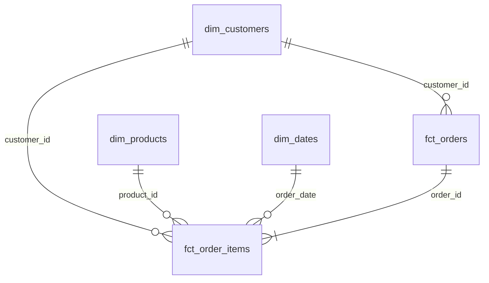
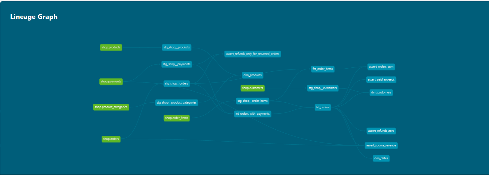

# Аналитический слой интернет-магазина (Greenplum + dbt)

Этот проект реализует аналитический слой (схему «Звезда») в хранилище Greenplum на основе сырых OLTP-данных магазина. Сборка моделей и тестирование данных выполняются с помощью dbt.

## Модель данных (Схема «Звезда»)

### Витрины и бизнес-вопросы

| Витрина | Зернистость (1 строка — это...) | На какой бизнес-вопрос отвечает |
| :--- | :--- | :--- |
| `fct_orders` | 1 заказ | Какая выручка по месяцам и категориям? Какой средний чек по городам? |
| `fct_order_items` | 1 товар в заказе | Какие бренды чаще покупают? Какие бренды чаще возвращают? |
| `dim_customers` | 1 клиент | Какова доля покупателей по каналам привлечения? |
| `dim_products` | 1 товар | Какая выручка по корневым категориям (Electronics vs Home)? |
| `dim_dates` | 1 день | Как меняются продажи по дням, неделям и выходным? |

## Хранение в Greenplum

## Хранение в Greenplum

| Витрина | Тип распределения | Обоснование |
| :--- | :--- | :--- |
| `fct_orders` | `order_id` | Крупная таблица фактов. Распределена по ключу заказа, чтобы `JOIN` с `fct_order_items` проходил локально на сегментах без пересылки данных по сети. |
| `fct_order_items` | `order_id` | Крупная таблица фактов. Распределена по `order_id` по той же причине. Используется колоночное хранение (`orientation='column'`), так как отчеты обычно читают только несколько колонок (например, сумму). |
| `dim_customers` | `distributed_replicated=true` | Маленькое измерение (40 строк). Полностью копируется на каждый сегмент, чтобы избежать пересылки строк при соединении с фактами. |
| `dim_products` | `distributed_replicated=true` | Маленькое измерение (13 строк). Копируется на каждый сегмент для быстрого `JOIN`. |
| `dim_dates` | `distributed_replicated=true` | Маленькое измерение (133 строки). Копируется на каждый сегмент для быстрого `JOIN`. |

## Результаты тестирования

В проекте настроены `generic` тесты (на уникальность, отсутствие пустых значений и связи между таблицами) и `singular` тесты на бизнес-логику.

**Найденная проблема:** 
Тест `assert_paid_exceeds` выявил аномалию: в **заказе 113** сумма успешных оплат (`paid_amount = 400`) превышает сумму самого заказа (`order_amount = 200`). Это может указывать на двойное списание средств клиента. Тест настроен с уровнем `severity: warn` и не останавливает сборку витрин, но сигнализирует о проблеме.

## Граф зависимостей

